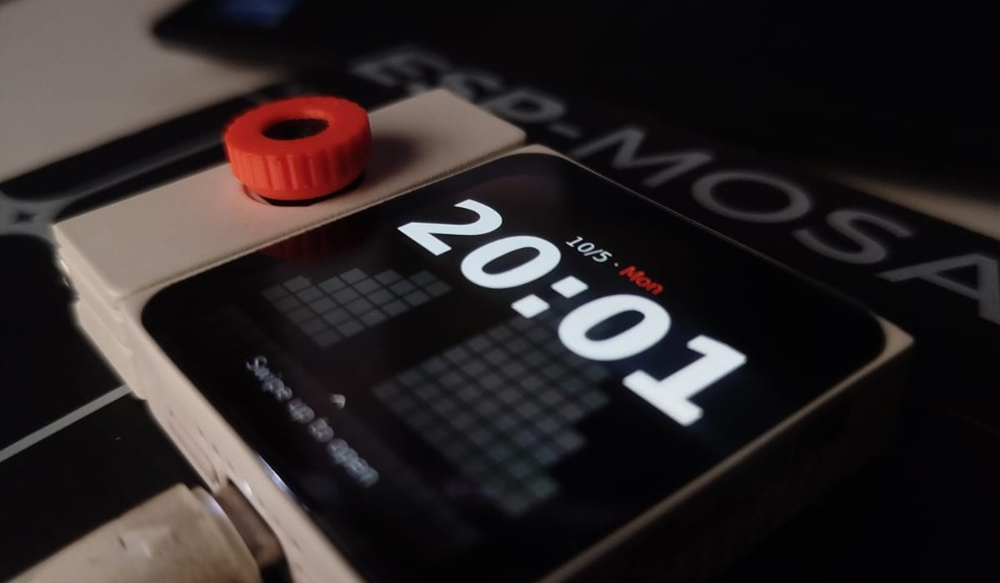
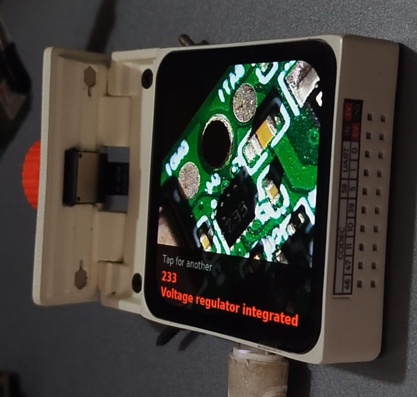
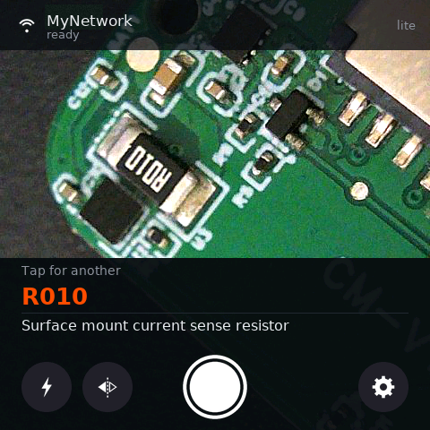
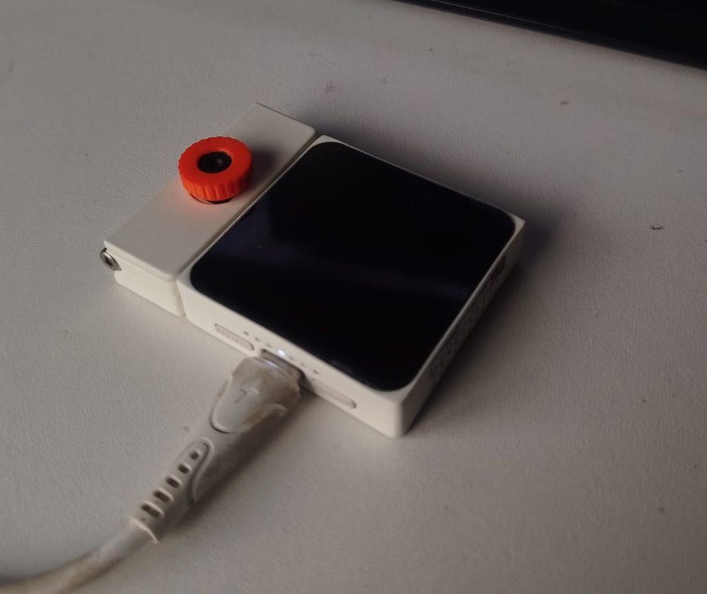

# Part ID



Point the camera at a component on a board. Tap. The part number comes back on
the screen, with one short line saying what the part is.

[](MOSAICO_IDEAS_URL)
[](INSTAGRAM_URL)

## It works



A 233 marking on a board pulled off the bench, read and named in one tap. No
datasheet, no squinting, no typing a half legible code into a search box.



The part number gets its own row in the accent colour. What the part is sits
underneath in plain text. That is the whole output, and it is meant to be read
at arm's length with a soldering iron in the other hand.

## Contents

1. [What you need](#what-you-need)
2. [Run it without building](#run-it-without-building)
3. [Give it a network and a key](#give-it-a-network-and-a-key)
4. [Using it](#using-it)
5. [Settings](#settings)
6. [Build from source](#build-from-source)
7. [Driving it over RPC](#driving-it-over-rpc)
8. [How the code is laid out](#how-the-code-is-laid-out)
9. [Troubleshooting](#troubleshooting)
10. [Where else to find this](#where-else-to-find-this)
11. [Licence](#licence)

## What you need



ESP-Mosaico, a modular board built on ESP32-S31. The core board, plus the
camera module seated in the LEFT slot. That is the whole bill of materials.

You also need a Gemini API key. The free tier is enough to try this. Vision
calls go to Google, so the board needs a 2.4 GHz network it can reach the
internet through.

The frame goes sensor to PPA to software JPEG, straight to the screen and
straight into the request. What you see is what the model sees.

## Run it without building

A prebuilt bundle ships in `prebuilt/`. No ESP-IDF, no toolchain, no compiler.

```powershell
.\m.ps1 iris system-update --bundle path\to\prebuilt\partid-1.0.0-system-update.irisfw
```

Run that from a Vibe workspace root, with the board on USB. It writes the
application and the UI resources, then validates both. There is a SHA256 to
check against in `prebuilt/README.md`.

Vibe Mode lives in the `factory` partition and is left alone, so you always
have a way back.

## Give it a network and a key

Nothing secret is compiled in. There is no credential anywhere in this
repository and none in the bundle. The wifi password and the API key arrive at
runtime over ESP-Iris RPC and live in the app owned `nvs` partition.

Replace the three placeholders below with your own values.

```powershell
.\m.ps1 iris rpc 20481 1 --payload "ssid=YOUR_WIFI_NAME"
.\m.ps1 iris rpc 20481 1 --payload "pass=YOUR_WIFI_PASSWORD"
.\m.ps1 iris rpc 20481 1 --payload "gkey=YOUR_GEMINI_API_KEY"
.\m.ps1 iris rpc 20481 2
```

Method 2 reports what is set and never prints the secrets back. It answers
with the SSID, whether a password and a key exist, the model name and the
prompt length.

Prefer tapping to typing? The board can raise its own access point instead.
Settings, then Setup portal. Join the network it names and open the address it
shows. The same fields are there in a browser form.

## Using it

Point the camera at one component. Tap the shutter, or tap anywhere in the
frame. Give it twenty seconds.

The answer comes back as two rows. The part number large in orange, and one
short line underneath saying what the part is. Tap again to go back to live
preview.

The torch button fills orange when the LED is on. Good markings need light and
a steady hand, and a close crop beats a wide one.

## Settings

Tap the gear. Six rows.

`Wi-Fi` picks a network from a scan. `API key` opens a keyboard. `Model` steps
through the vision models. `Rotation` shows the sensor rotation and is read
only on the board. `Mirror` flips the preview for when you hold the board
facing yourself. `Setup portal` raises the access point.

`model`, `prompt`, `rot`, `flip` and `cycle` can also be set over RPC with
method 1, the same way as the credentials.

Orientation matters more than it looks like it should. A rotated or mirrored
frame still looks like a perfectly good photo of a PCB, and the model will
confidently read a garbled part number off it. If answers are plausible but
wrong, photograph something with writing on it and check you can read the
writing on screen.

## Build from source

Clone this into a Vibe workspace as `projects/partid`. Then from the workspace
root run

```powershell
.\m.ps1 iris system-update --project projects/partid
```

Use `system-update` rather than `app-update`. On Windows `app-update` is
unreachable while the recover reset bug stands.

The screen layout is generated rather than written by hand. `ui/build_scene.py`
emits `ui/main.json`, which the build compiles into the UI bundle. Edit the
Python, run it, rebuild.

```powershell
cd ui
python build_scene.py
```

There is also a host backend under `pc/` for previewing the scene in the ESP-GSP
simulator without a board.

## Driving it over RPC

Every control is reachable without touching the screen, which is what makes
unattended runs possible.

```powershell
.\m.ps1 iris rpc 20481 3    # fire one identification
.\m.ps1 iris rpc 20481 4    # fetch the last one as JSON
```

Method 4 returns the answer text plus the numbers that answer cost. Bytes
sent, bytes received, JPEG size, encode time, wifi connect time, request and
response times, signal strength and token counts.

Every query also emits one log line of nothing but numbers, so
`iris logs | Select-String QUERY` is already a table.

That shape is deliberate. Capture, wifi and request are timed apart, and the
camera and the encode loop stop before the radio starts, so a current trace
shows the query and not the camera. Measuring what one cloud vision query
costs a battery is the second half of this work and lands here later.

## How the code is laid out

| File | What lives there |
| --- | --- |
| `main/main.c` | State machine, screen updates, the query worker |
| `main/partid_camera.c` | Sensor, PPA scaling and rotation, JPEG encode, preview |
| `main/partid_vision.c` | The HTTPS request and the response parse |
| `main/partid_net.c` | Station bring up and timing |
| `main/partid_config.c` | Settings in NVS, defaults, the prompt |
| `main/partid_rpc.c` | The ESP-Iris RPC service on 20481 |
| `main/partid_portal.c` | The setup access point and its web form |
| `main/partid_ui.c` | Settings, network picker and keyboard pages |
| `ui/build_scene.py` | Generates the screen layout |

Start at `partid_camera.c` and `partid_vision.c`. The comments explain why
things are shaped the way they are, and most of it was not the obvious choice.

## Troubleshooting

**Model unavailable, change it in Settings.** A 404. Some older model names are
refused to new API keys even though they still appear in the model list. Step
`Model` in Settings, or set a different one over RPC.

**Daily quota used up.** A 429. The free tier is capped per model per day. Try
another model or wait.

**API key refused.** A 403, or a 400 if the request itself was rejected. Check
the key was stored whole, then check it is enabled for the Gemini API.

**No answer, or a transport failure on the first query after boot.** The first
request after joining a network sometimes fails before a byte goes out. Tap
again. If it keeps failing, the network probably has no route to the internet.

**No camera, check the LEFT module.** The module's I2C bus is occasionally
still busy at startup. The firmware retries four times a second apart, and
tapping the shutter retries again. If it persists, reseat the module.

**The answer is cut off and ends in [cut].** The model spent its output budget
on thinking. Pick a different model.

**The board is unreachable.** Hold the AI button on GPIO7 while powering on to
boot back into Vibe Mode.

## Where else to find this

Flash it from the Mosaico Ideas gallery and skip the clone entirely. Build
photos, the bits that did not work, and whatever gets built next go on
Instagram.

[](MOSAICO_IDEAS_URL)
[](INSTAGRAM_URL)

## Licence

Apache-2.0, see `LICENSE`. The DejaVu fonts under `ui/fonts` keep their own
licence, see `ui/fonts/LICENSE`.
